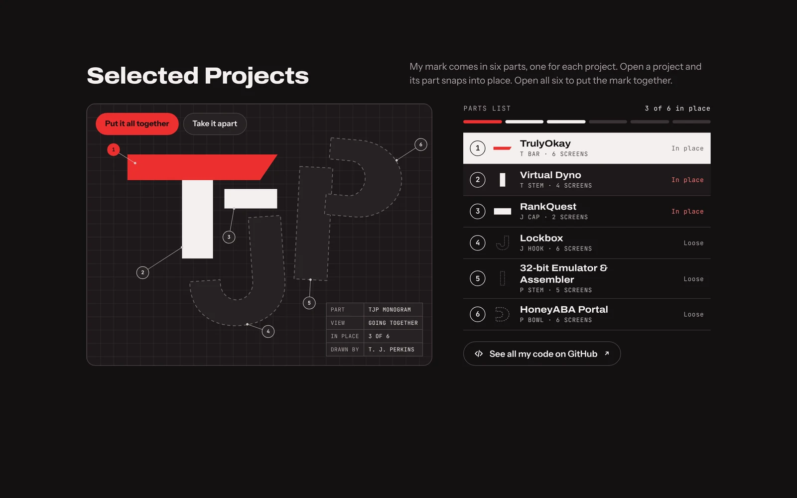
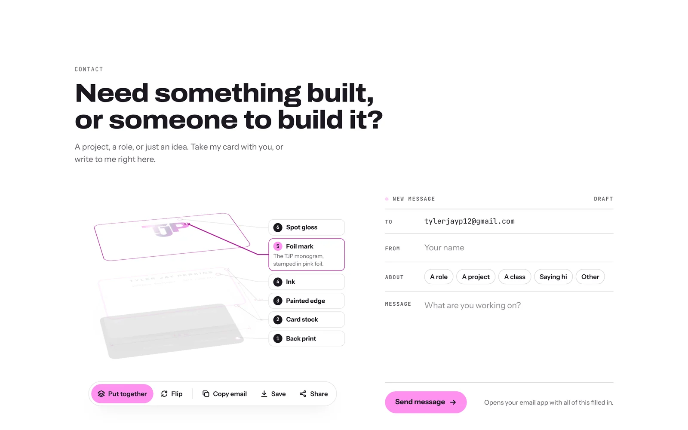

# tylerjayp.com

My portfolio website: **[tylerjayp.com](https://www.tylerjayp.com)**

I'm Tyler Jay Perkins, a software developer in Salt Lake City and a Master of Computer Science student at
Utah Valley University. This site is where I show what I build and how I build it.


## What's on it

- **An intro that builds itself.** My TJP mark draws itself in, a terminal "builds" my projects, and then
  it hands over to a short video of me talking about my work, with captions on by default.
- **Hiring? Paste your job posting.** Paste in a job description and the site shows which of its skills I
  can back up, with the project or job that proves each one. Most come with a "Hear it" button that plays
  the part of the video where I talk about that skill. It all runs in your browser; nothing is sent
  anywhere.
- **Selected Projects.** My mark is made of six parts, one for each project. Open a project and its part
  snaps into place; open all six to put the mark together. Each project has screenshots, the stack it uses
  and why I built it: TrulyOkay, Virtual Dyno, RankQuest, Lockbox, my 32-bit Emulator & Assembler and
  the HoneyABA Portal.
- **Experience and Resume.** Where I've worked and studied, and my full resume, readable on the page or as a
  PDF.
- **A 3D business card.** Take it apart into its six print layers, flip it over, copy my email, save my
  contact card to your phone, or write me a message that opens in your email app.
- **Light and dark mode**, with pink as the accent in light mode and red in dark. It works on phones, with
  the keyboard alone, and with reduced motion turned on.





## How it's built

**React 19, TypeScript and Vite**, styled with **CSS Modules** on a shared set of design tokens, tested with
**Vitest and Testing Library**, linted with **ESLint and Prettier**, checked by **GitHub Actions** on every
push and pull request, and hosted on **AWS Amplify** with DNS on Route 53.

- **Content is data.** Everything the page says lives in `src/content` (projects, resume, skills, captions),
  so adding a project or changing a skill is an edit to a list, not to a component.
- **Logic is pure and tested.** The job matcher, the build terminal's timeline, the scroll-reveal rules and
  the business card's spring physics are plain functions with unit tests, separate from the components that
  draw them.
- **No animation library and no backend.** The reveals and the card physics are written by hand, and
  everything runs in the browser.
- **Strict by default.** TypeScript in strict mode, braces on every `if`, no non-null assertions, a limit on
  how complex a function can get, and Prettier checked in CI.

```
src/
  content/      What the page says, as typed data
  lib/          Pure logic with unit tests
  providers/    The theme and scroll-reveal providers
  hooks/        useTheme, useReveal, the intro sequence, dialogs, the animation loop
  components/   One folder per section, each with its own CSS Module
  styles/       Design tokens for both themes, base styles and the animations
public/         Screenshots, the intro video, the resume PDF and icons
```

## Running it locally

```bash
nvm use            # Node 22 (see .nvmrc)
npm ci
npm run dev        # http://localhost:5173
```

| Command           | What it does                                 |
| ----------------- | -------------------------------------------- |
| `npm run dev`     | Dev server that reloads as you save          |
| `npm test`        | Runs the unit and component tests            |
| `npm run lint`    | ESLint                                       |
| `npm run build`   | Type-checks, then builds the site to `dist/` |
| `npm run preview` | Serves that build at http://localhost:4173   |

Every push to `main` deploys: `amplify.yml` tells Amplify to use Node 22, run `npm ci` and `npm run build`,
and publish `dist/`.
